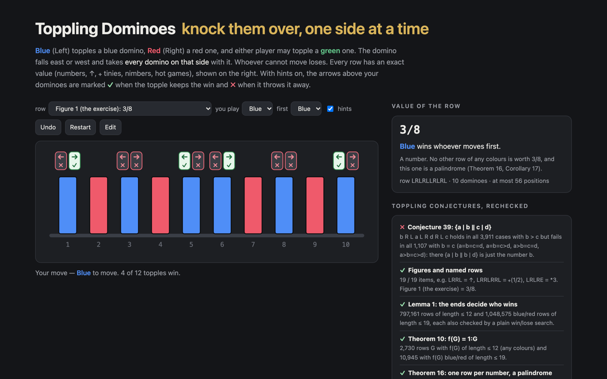

# Toppling Dominoes

Toppling Dominoes in the browser, with an exact combinatorial-game-theory engine behind it. A row of blue (Left), red (Right) and green (either player) dominoes stands on the table. On your turn you topple one of your dominoes east or west; it falls together with every domino on that side. Whoever cannot move loses.

Every row gets its canonical value (numbers, ↑, ⧾ tinies, nimbers, hot games), every topple is marked as winning or losing, a computer plays the other side, and any row of up to 24 dominoes can be typed in.



The demo opens on Figure 1 of the paper below, which the paper leaves as an exercise: LRLRLLRLRL = 3/8.

## Run it

```sh
npm install
npm run dev        # http://localhost:5173/portfolio/toppling-dominoes/
npm test           # 24 tests
npm run build      # static site in dist/
```

## How it works

- `src/toppling.ts`: rows as strings over `L`, `R`, `E` (west to east). Toppling domino i west leaves `s[i+1..]`, east leaves `s[..i-1]`, so every position is a substring and the `Valuer` memoises values by the row itself. `Searcher` decides who wins by plain search, without values, to check the engine. Also the paper's constructions: `f` (Definition 9), `ordinalOne` (1:G), `numberRow(x)` (the unique row worth x), `minyRow`, `tinyRow`, `nimberRow`.
- `src/cgt.ts`: short games in canonical form (dominated options deleted, reversible ones bypassed), interned so that equal values have equal ids; comparison, sums, stops, names. Shared with the Hackenbush and Clobber entries.
- `src/main.ts`: the demo. The side panel lists the checks below, read from `src/findings.json`.

## Checked against the literature

`tools/verify.mts` recomputes A. Fink, R. J. Nowakowski, A. N. Siegel and D. Wolfe, *Toppling Conjectures*, Games of No Chance 4, MSRI Publications 63 (2015) 65–76. The figures are drawings; they were transcribed from the PDF rendered at 400 dpi (black = L, white = R, gray = E).

```sh
node tools/verify.mts                 # figures and named rows → runs/paper.json
node tools/verify.mts sweep LRE 12    # every row over L, R, E up to length 12 → runs/sweep-LRE-12.json
node tools/verify.mts sweep LR 19     # every blue/red row up to length 19 → runs/sweep-LR-19.json
node tools/report.mts 19 12           # the tables below, and src/findings.json
```

A sweep values every row once, shortest first (all options of a row are shorter, so already known), and checks every claim that quantifies over rows.

- ✓ **Figures and named rows.** 19 / 19 items, e.g. LRRL = ↑, LRRLRRL = ⧾(1/2), LRLRE = \*3. Figure 1 (the exercise) = 3/8.
- ✓ **Lemma 1: the ends decide who wins.** 797,161 rows of length ≤ 12 and 1,048,575 blue/red rows of length ≤ 19, each also checked by a plain win/lose search.
- ✓ **Theorem 10: f(G) = 1:G.** 2,730 rows G with f(G) of length ≤ 12 (any colours) and 10,945 with f(G) blue/red of length ≤ 19.
- ✓ **Theorem 16: one row per number, a palindrome.** 63 numbers among rows of length ≤ 12, 139 among blue/red rows of length ≤ 19; each taken by exactly one row.
- ✓ **Theorem 21 and Conjecture 22: tinies.** R L x L R = ⧿(x) and nothing else is: 30 tinies/minies fit in length ≤ 12 (any colours), 94 in blue/red length ≤ 19. The paper went to 15.
- ✓ **Theorem 29: \*m has m blue/red forms.** \*1…\*9: every blue/red row of length ≤ 19 equal to \*m is (LR)^a (RL)^m (LR)^a or its reverse, and every such row that fits is found.
- ✓ **Lemmas 30–31: shape of infinitesimals.** 199,296 infinitesimal rows (any colours, ≤ 12): the first player can always reach a nimber, and every other move can be answered by one.
- ℹ **Theorem 32: atomic weight 0, ±1.** Not recomputed: these infinitesimals are not all-small, and the paper only sketches the substitution that makes the atomic-weight recursion apply.
- ✓ **Conjecture 33: {1 | 0, {0 | −1}} needs green.** No blue/red row of length ≤ 19 has this value; with green it is LERE and 3 other rows of length ≤ 12.
- ✓ **Conjecture 34: x L y > x y.** 12,492,971 insertions, strictly greater every time.
- ✓ **Conjecture 35: blue/red palindromes are unique.** 3,069 palindromes of length ≤ 19; no other blue/red row shares a value with one.
- ✓ **Theorem 36, Conjectures 37–38.** {a | b} = a L R b: 1,544 rows; {a ‖ b | c} = a L R c R L b: 4,440 rows (length ≤ 19); all equal and unique up to reversal.
- ✗ **Conjecture 39: {a | b ‖ c | d}.** b R L a L R d R L c holds in all 3,911 cases with b > c but fails in all 1,107 with b = c (a=b=c=d, a=b=c>d, a>b=c=d, a>b=c>d): there {a | b ‖ b | d} is just the number b.
- ℹ **Conjecture 40: some games never occur.** 18 of the 22 games born by day 2 appear in rows of length ≤ 12; missing: ↓\*, ↑\*, {0, \* | −1}, {1 | 0, \*}.
- ℹ **Blue/red rows almost never share a value.** Up to reversal, only 16 values of blue/red rows of length ≤ 19 are taken by two different rows, 6 of them nimbers (Theorem 29).

### Conjecture 39, split by ties

b R L a L R d R L c = {a | b ‖ c | d} for numbers a ≥ b ≥ c ≥ d, every combination whose row has length ≤ 19:

| pattern | cases | value as claimed | claimed game is a number |
|---|---|---|---|
| a=b=c=d | 9 | 0 | 9 |
| a=b=c>d | 128 | 0 | 128 |
| a=b>c=d | 68 | 68 | 0 |
| a=b>c>d | 647 | 647 | 0 |
| a>b=c=d | 128 | 0 | 128 |
| a>b=c>d | 842 | 0 | 842 |
| a>b>c=d | 647 | 647 | 0 |
| a>b>c>d | 2549 | 2549 | 0 |

It fails exactly when b = c: then G − b = {a − b | 0 ‖ 0 | d − b} is a second-player win, so the claimed game is the number b, whose only row (Theorem 16) is not this one.

### Sweeps

**All rows over L, R, E**

| length | rows | new values | numbers | hot | infinitesimal | time |
|---|---|---|---|---|---|---|
| 0 | 1 | 1 | 1 | 0 | 1 | 1 ms |
| 1 | 3 | 3 | 2 | 0 | 1 | 0 ms |
| 2 | 9 | 5 | 2 | 4 | 3 | 0 ms |
| 3 | 27 | 14 | 4 | 14 | 7 | 1 ms |
| 4 | 81 | 30 | 2 | 52 | 21 | 3 ms |
| 5 | 243 | 88 | 6 | 164 | 61 | 7 ms |
| 6 | 729 | 224 | 4 | 500 | 183 | 42 ms |
| 7 | 2,187 | 683 | 6 | 1,514 | 547 | 119 ms |
| 8 | 6,561 | 1,953 | 4 | 4,564 | 1,641 | 451 ms |
| 9 | 19,683 | 5,953 | 10 | 13,696 | 4,921 | 2.5 s |
| 10 | 59,049 | 17,733 | 4 | 41,116 | 14,763 | 14.6 s |
| 11 | 177,147 | 54,014 | 12 | 123,374 | 44,287 | 143.1 s |
| 12 | 531,441 | 163,216 | 6 | 370,124 | 132,861 | 649.5 s |

**Blue/red rows**

| length | rows | new values | numbers | hot | infinitesimal | time |
|---|---|---|---|---|---|---|
| 0 | 1 | 1 | 1 | 0 | 1 | 2 ms |
| 1 | 2 | 2 | 2 | 0 | 0 | 1 ms |
| 2 | 4 | 3 | 2 | 0 | 2 | 1 ms |
| 3 | 8 | 6 | 4 | 4 | 0 | 1 ms |
| 4 | 16 | 10 | 2 | 6 | 4 | 0 ms |
| 5 | 32 | 20 | 6 | 24 | 2 | 2 ms |
| 6 | 64 | 36 | 4 | 44 | 10 | 3 ms |
| 7 | 128 | 72 | 6 | 100 | 12 | 6 ms |
| 8 | 256 | 135 | 4 | 202 | 32 | 20 ms |
| 9 | 512 | 272 | 10 | 424 | 54 | 33 ms |
| 10 | 1,024 | 527 | 4 | 832 | 118 | 114 ms |
| 11 | 2,048 | 1,056 | 12 | 1,708 | 224 | 289 ms |
| 12 | 4,096 | 2,079 | 6 | 3,398 | 460 | 642 ms |
| 13 | 8,192 | 4,158 | 8 | 6,816 | 906 | 1.4 s |
| 14 | 16,384 | 8,253 | 8 | 13,648 | 1,826 | 3.5 s |
| 15 | 32,768 | 16,512 | 16 | 27,328 | 3,636 | 9.2 s |
| 16 | 65,536 | 32,892 | 6 | 54,626 | 7,288 | 21.0 s |
| 17 | 131,072 | 65,792 | 18 | 109,324 | 14,558 | 75.6 s |
| 18 | 262,144 | 131,323 | 8 | 218,604 | 29,134 | 287.8 s |
| 19 | 524,288 | 262,654 | 12 | 437,268 | 58,248 | 966.6 s |

## License

MIT

<!-- sen-publish:links -->
## Links

- 🌐 Demo: https://sen.ltd/portfolio/toppling-dominoes/
- 📝 記事: https://qiita.com/sen-ltd/items/7436326918cf34fc82fc
<!-- /sen-publish:links -->
